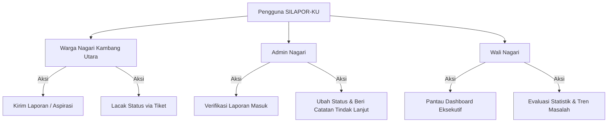
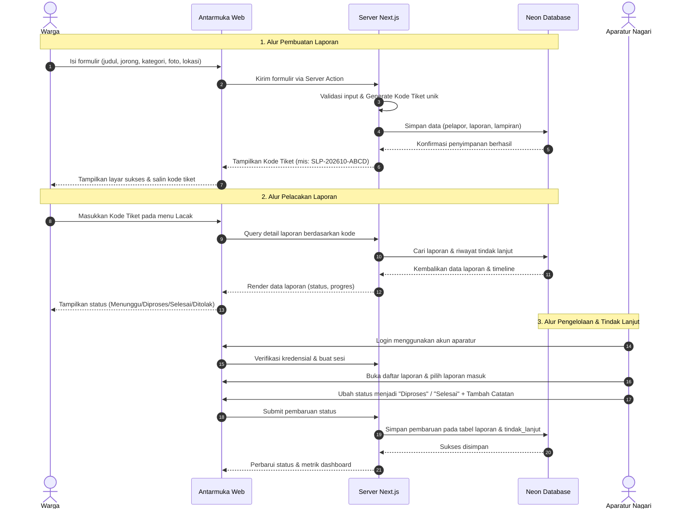
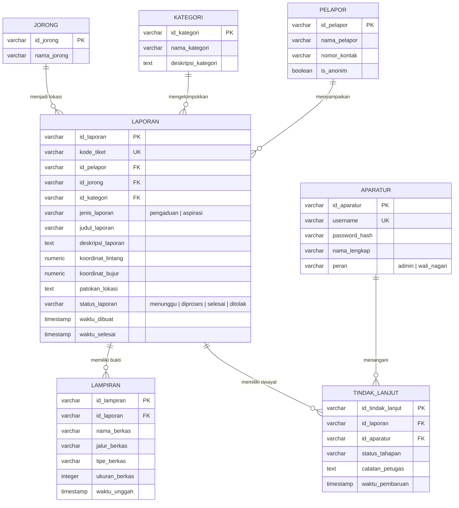

# Product Requirements Document (PRD)
## SILAPOR-KU (Sistem Informasi Layanan Pengaduan Nagari Kambang Utara)

---

| Informasi Dokumen | Detail |
| :--- | :--- |
| **Nama Proyek** | SILAPOR-KU |
| **Pemilik Proyek (Project Owner)** | Pemerintahan Nagari Kambang Utara |
| **Tim Pengembang** | IS-SIA |
| **Versi Dokumen** | 1.0 |
| **Tanggal Terbit** | 10 Oktober 2026 |
| **Status** | Disetujui (Approved) |

---

## 1. Pendahuluan & Latar Belakang

### 1.1 Problem Statement
Pengelolaan pengaduan dan aspirasi masyarakat merupakan pilar penting dalam pelayanan publik di Nagari Kambang Utara. Saat ini, warga membutuhkan sarana yang mudah dan cepat untuk menyampaikan keluhan serta aspirasi, sementara aparatur nagari membutuhkan mekanisme yang terstruktur untuk menerima, memvalidasi, menindaklanjuti, dan memantau status penanganan laporan.

Tantangan yang dihadapi:
- Belum tersedianya sarana pelaporan terpadu yang dapat diakses secara fleksibel dari peramban ponsel pintar maupun komputer.
- Ketiadaan nomor rujukan/tiket unik yang transparan bagi warga untuk memantau sejauh mana laporannya telah diproses.
- Ketiadaan dashboard pemantauan terpusat bagi Wali Nagari dan aparatur nagari untuk mengevaluasi volume keluhan per wilayah jorong dan kategori isu pelayanan publik.

Oleh karena itu, **SILAPOR-KU** dikembangkan sebagai platform berbasis web responsif untuk menjembatani komunikasi publik antara warga dan Pemerintah Nagari Kambang Utara melalui pelaporan transparan, kode tiket unik, dan pemantauan real-time.

### 1.2 Target Pengguna (User Persona)

Sistem melayani tiga aktor utama dengan karakteristik dan wewenang yang berbeda:

#### 1. Warga Nagari Kambang Utara
* **Peran**: Penyampai pengaduan atau aspirasi publik.
* **Karakteristik & Kebutuhan**:
  - Membutuhkan formulir yang simpel tanpa perlu mengunduh aplikasi terpisah (berbasis web).
  - Mengunggah detail aduan: judul, deskripsi, kategori, wilayah jorong, koordinat/patokan lokasi, dan foto bukti.
  - Opsi menyampaikan laporan dengan identitas jelas atau secara **anonim**.
  - Memperoleh **kode tiket unik** untuk melacak perkembangan status penanganan laporan secara mandiri.

#### 2. Admin Nagari
* **Peran**: Pengelola operasional harian laporan yang masuk.
* **Karakteristik & Kebutuhan**:
  - Memiliki akun kredensial terotentikasi.
  - Memeriksa keabsahan laporan, lampiran bukti, dan detail lokasi kejadian.
  - Memperbarui status penanganan laporan (*Menunggu Pemeriksaan*, *Diproses*, *Selesai*, *Ditolak*).
  - Memberikan catatan progres penanganan resmi (*progress notes* / audit trail).

#### 3. Wali Nagari Kambang Utara
* **Peran**: Pimpinan eksekutif nagari untuk monitoring, evaluasi, dan pengambilan kebijakan.
* **Karakteristik & Kebutuhan**:
  - Akses ringkasan eksekutif (dashboard analitik) secara real-time.
  - Mengetahui volume total pengaduan, sebaran per jorong, kategori terbanyak, serta tingkat penyelesaian (*completion rate*).
  - Bahan evaluasi kinerja pelayanan perangkat nagari kepada warga.

### 1.3 User Needs & Pain Points
| Pain Point Terdahulu | Kebutuhan Pengguna | Solusi SILAPOR-KU |
| :--- | :--- | :--- |
| Penyampaian aspirasi manual/tersebar (WhatsApp, lisan, surat fisik) | Sarana digital terpusat dan mudah diakses kapan saja | Formulir web terstruktur dengan upload bukti foto dan titik lokasi |
| Warga tidak tahu nasib laporannya setelah disampaikan | Kepastian dan transparansi proses | Pelacakan publik instan berbasis Kode Tiket unik |
| Rekapitulasi laporan rentan tercecer | Pengelolaan arsip keluhan yang tertata | Manajemen status dan riwayat tindak lanjut terpusat |
| Wali Nagari kesulitan memetakan masalah krusial di tiap jorong | Visualisasi data untuk bahan evaluasi | Dashboard pemantauan interaktif dengan statistik wilayah & kategori |
| Ketakutan warga akan intimidasi identitas saat melapor | Jaminan privasi dan kerahasiaan | Opsi pelaporan anonim dengan proteksi data pelapor |

### 1.4 Tujuan Proyek (Project Goal)
Mengembangkan website SILAPOR-KU sebagai sarana digital yang memudahkan masyarakat Nagari Kambang Utara dalam menyampaikan pengaduan dan aspirasi serta memantau status penanganan laporan melalui kode tiket. Sistem ini juga bertujuan membantu aparatur nagari mengelola laporan secara terstruktur dan mendukung pemantauan perkembangan penanganan pengaduan melalui dashboard.

---

## 2. Kebutuhan Produk (Product Requirements)

### 2.1 Kebutuhan Fungsional (Functional Requirements)

#### Modul A: Pelaporan Pengaduan dan Aspirasi
| ID | Kebutuhan Fungsional |
| :--- | :--- |
| **FR-01** | Sistem menyediakan formulir bagi warga untuk menyampaikan pengaduan atau aspirasi. |
| **FR-02** | Sistem memungkinkan warga mengisi informasi laporan: judul, kategori, deskripsi, dan wilayah jorong. |
| **FR-03** | Sistem memungkinkan warga melampirkan foto bukti serta informasi koordinat (GPS) dan patokan lokasi kejadian. |
| **FR-04** | Sistem menyediakan pilihan pelaporan menggunakan identitas pelapor atau secara anonim. |
| **FR-05** | Sistem memvalidasi kelengkapan data wajib dan format berkas lampiran sebelum formulir dikirimkan. |
| **FR-06** | Sistem menyimpan laporan yang valid dan mengenerate **kode tiket unik** otomatis sebagai tanda pengenal. |
| **FR-07** | Sistem menampilkan halaman konfirmasi pengiriman yang memuat kode tiket dan tautan pelacakan. |
| **FR-08** | Sistem menampilkan notifikasi kesalahan informatif jika pengiriman gagal atau data tidak valid. |

#### Modul B: Pelacakan Status Laporan
| ID | Kebutuhan Fungsional |
| :--- | :--- |
| **FR-09** | Sistem menyediakan fitur pelacakan laporan berbasis pencarian kode tiket unik. |
| **FR-10** | Sistem menampilkan rincian laporan yang sesuai dengan kode tiket valid tanpa membocorkan identitas privat publik. |
| **FR-11** | Sistem menampilkan status penanganan laporan: `Menunggu Pemeriksaan`, `Diproses`, `Selesai`, atau `Ditolak`. |
| **FR-12** | Sistem menyajikan lini masa (*timeline*) pembaruan status dan catatan penanganan terkini dari aparatur. |

#### Modul C: Autentikasi dan Akses Aparatur
| ID | Kebutuhan Fungsional |
| :--- | :--- |
| **FR-13** | Sistem menyediakan mekanisme login aman untuk aparatur nagari menggunakan username dan kata sandi terenkripsi. |
| **FR-14** | Sistem membatasi hak akses halaman dan tindakan (*Role-Based Access Control*) antara Admin Nagari dan Wali Nagari. |
| **FR-15** | Sistem menyediakan fungsi logout untuk mengakhiri sesi autentikasi dengan aman. |

#### Modul D: Pengelolaan Laporan oleh Aparatur
| ID | Kebutuhan Fungsional |
| :--- | :--- |
| **FR-16** | Sistem menampilkan daftar seluruh laporan masyarakat dengan filter status, kategori, jorong, dan rentang tanggal. |
| **FR-17** | Sistem menyediakan halaman detail laporan yang memuat foto bukti resolusi penuh, lokasi peta/koordinat, dan data pelapor (jika non-anonim). |
| **FR-18** | Sistem memungkinkan Admin Nagari memperbarui status penanganan laporan. |
| **FR-19** | Sistem memungkinkan aparatur mencantumkan catatan penanganan resmi untuk setiap tahapan tindak lanjut. |
| **FR-20** | Sistem mencatat riwayat perubahan status, aparatur yang menangani, serta stempel waktu (*audit trail*). |

#### Modul E: Dashboard Pemantauan Eksekutif
| ID | Kebutuhan Fungsional |
| :--- | :--- |
| **FR-21** | Sistem menyediakan dashboard pemantauan khusus pimpinan (Wali Nagari dan Admin). |
| **FR-22** | Sistem menampilkan metrik total laporan masuk, laporan selesai, laporan diproses, dan laporan ditolak. |
| **FR-23** | Sistem menampilkan grafik ringkasan distribusi laporan berdasarkan kategori keluhan/aspirasi. |
| **FR-24** | Sistem menampilkan grafik sebaran laporan berdasarkan wilayah jorong di Nagari Kambang Utara. |
| **FR-25** | Sistem memperbarui metrik visual dashboard secara dinamis berdasarkan data terkini database. |

#### Modul F: Penanganan Kondisi Kesalahan & Validasi
| ID | Kebutuhan Fungsional |
| :--- | :--- |
| **FR-26** | Sistem menampilkan peringatan jika kode tiket pelacakan tidak ditemukan atau salah format. |
| **FR-27** | Sistem mengalihkan pengguna dan memunculkan notifikasi akses ditolak jika mencoba mengakses halaman tanpa otorisasi. |
| **FR-28** | Sistem memberikan umpan balik langsung jika berkas lampiran melebihi batas ukuran atau ekstensi tidak didukung. |

---

### 2.2 Kebutuhan Non-Fungsional (Non-Functional Requirements)

| ID | Parameter | Spesifikasi & Batasan |
| :--- | :--- | :--- |
| **NFR-01** | **Kinerja (Performance)** | Waktu muat halaman utama dan pelacakan ditargetkan $\le 3$ detik pada koneksi internet seluler standar (4G). |
| **NFR-02** | **Kemudahan Penggunaan (Usability)** | Seluruh antarmuka menggunakan Bahasa Indonesia formal & komunikatif, tata letak intuitif, dan tombol aksi yang jelas. |
| **NFR-03** | **Kompatibilitas** | Berjalan mulus di seluruh peramban modern (Chrome, Safari, Firefox, Edge) pada desktop, tablet, dan smartphone. |
| **NFR-04** | **Responsivitas UI** | Desain sepenuhnya *mobile-responsive* menggunakan Tailwind CSS flex/grid layout tanpa kerusakan komponen pada resolusi kecil ($\ge 360px$). |
| **NFR-05** | **Keamanan Data** | Kredensial akun aparatur di-hash dengan algoritma aman (misal: bcrypt/argon2), tidak disimpan dalam teks polos (*plain text*). |
| **NFR-06** | **Kontrol Akses** | Proteksi endpoint dan *Server Actions* dengan validasi sesi role pengguna sebelum mutasi data dijalankan. |
| **NFR-07** | **Privasi & Kerahasiaan** | Identitas pelapor yang memilih opsi *anonim* disamarkan dari publik dan hanya metadata laporan esensial yang diekspos di fitur pelacakan. |
| **NFR-08** | **Keandalan (Reliability)** | Penyimpanan data persisten di PostgreSQL dengan ketersediaan tinggi (*high-availability*) via Neon Serverless. |
| **NFR-09** | **Integritas Data** | Penggunaan *foreign key constraints*, schema validation (Zod), dan *type-safe query* (Drizzle ORM) untuk mencegah data *corrupt*. |
| **NFR-10** | **Error Handling** | Pesan galat user-friendly yang tidak membocorkan stack trace, struktur database, atau rahasia server ke sisi klien. |
| **NFR-11** | **Maintainability** | Struktur kode modular Next.js App Router (`src/app`, `src/components`, `src/db`, `src/lib`) dengan panduan TypeScript ketat. |
| **NFR-12** | **Resiliensi Jaringan** | Penanganan *network error* yang anggun (*graceful fallback*) saat perangkat pengguna mengalami gangguan sinyal. |
| **NFR-13** | **Manajemen Lampiran** | Pembatasan tipe berkas gambar (JPG, PNG, WebP) dengan batas maksimal ukuran berkas (maksimal 5 MB). |
| **NFR-14** | **Pencadangan (Backup)** | Mengandalkan fitur point-in-time recovery dan branch snapshot dari infrastruktur database serverless Neon. |

---

## 3. Alur Pengguna (User Flows)

---

## 4. Kebutuhan Data & Skema Relasional (Data Requirements)

Data disimpan secara relasional pada database PostgreSQL dengan entitas sebagai berikut:

---

## 5. Batasan & Asumsi (Constraints & Assumptions)

### 5.1 Batasan (Constraints)
1. **Platform**: Berbasis web (aplikasi peramban). Tidak dikembangkan menjadi aplikasi *native* Android (APK) atau iOS pada rilis 1.0.
2. **Konektivitas**: Membutuhkan sambungan internet aktif untuk pengiriman laporan, pelacakan, dan pembaruan data.
3. **Perangkat**: Memerlukan izin akses peramban terhadap GPS dan Kamera jika pelapor mengambil titik koordinat dan foto secara *live*.
4. **Waktu Pengerjaan**: Terikat oleh batas waktu proyek perkuliahan Semester 5.

### 5.2 Asumsi (Assumptions)
1. Mayoritas warga memiliki akses smartphone atau komputer dengan peramban modern.
2. Aparatur nagari aktif memeriksa laporan masuk secara berkala setiap hari kerja.
3. Peta jorong Nagari Kambang Utara telah teridentifikasi secara jelas untuk pilihan referensi dropdown.

---

## 6. Ruang Lingkup (Scope of Work)

### 6.1 Dalam Ruang Lingkup (In-Scope)
- Antarmuka publik responsif untuk penyampaian pengaduan dan aspirasi.
- Form upload foto bukti dan koordinat/patokan lokasi kejadian.
- Mode pelaporan beridentitas maupun anonim.
- Modul pelacakan real-time menggunakan kode tiket unik.
- Sistem autentikasi aparatur dengan kontrol peran (Admin Nagari & Wali Nagari).
- Manajemen alur laporan (ubah status, catatan verifikasi, riwayat penanganan).
- Dashboard analitik untuk Wali Nagari (statistik status, grafik kategori, sebaran jorong).

### 6.2 Di Luar Ruang Lingkup (Out-of-Scope)
- Eksekusi teknis perbaikan fisik di lapangan dan pencairan anggaran APB-Nagari.
- Integrasi langsung dengan API Kependudukan Nasional (Dukcapil) untuk validasi NIK.
- Portal berita atau fitur promosi pariwisata nagari.
- Integrasi CMS portal induk Kabupaten Pesisir Selatan / DPMD.
- Pembuatan aplikasi native mobile di Google Play Store atau Apple App Store.

---

## 7. Kriteria Keberhasilan (Success Criteria)

1. **Kelengkapan Laporan**: Minimal 80% laporan yang masuk dilengkapi dengan lampiran foto bukti yang jelas serta informasi lokasi/jorong yang valid.
2. **Kemudahan Penggunaan (Usability)**: Warga dapat menyelesaikan pengisian dan submit formulir laporan dalam waktu $\le 3$ menit.
3. **Transparansi Sistem**: 100% laporan tersimpan berhasil memperoleh kode tiket unik dan statusnya dapat diverifikasi di halaman pelacakan.
4. **Kesiapan Informasi Pimpinan**: Dashboard Wali Nagari menyajikan visualisasi data yang akurat dan *real-time* sesuai status penanganan terkini.
